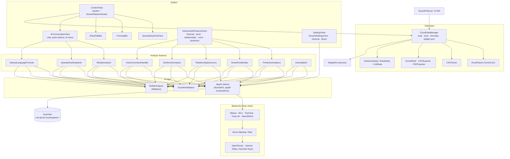
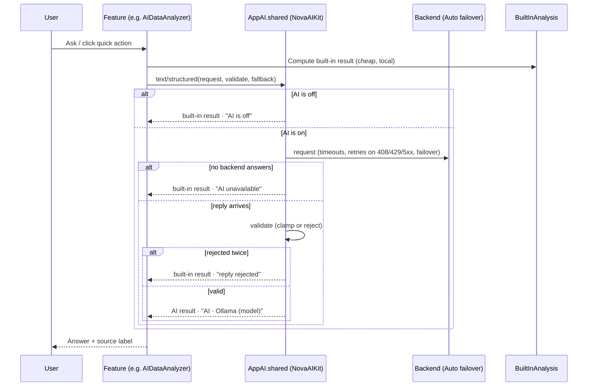
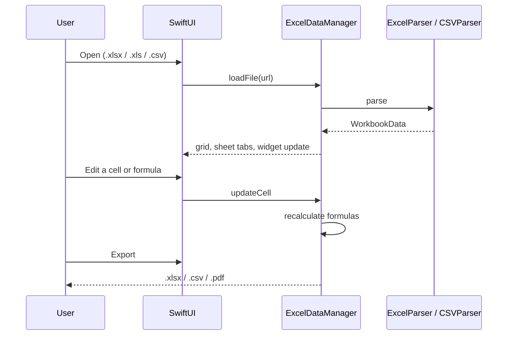

# ExcelExplorer

A native macOS spreadsheet viewer, editor and analyzer. Opens .xlsx, .xls and .csv files, edits cells and formulas, exports to XLSX/CSV/PDF, and analyzes your data, with AI when you want it and with built-in statistics when you don't.


---

## Features

### Spreadsheets

| Feature | Description |
|---------|-------------|
| File formats | Open and edit .xlsx (CoreXLSX), .xls and .csv |
| Cell editing | Inline editing for strings, numbers, dates, booleans and formulas |
| Formula engine | SUM, AVERAGE, COUNT, MIN, MAX with ranges and automatic recalculation; unknown functions return `#NAME?` and are never executed |
| Sheets | Tab bar for switching, adding and removing worksheets |
| XLSX export | Full Office Open XML writer (content types, workbook, shared strings, per-sheet XML, ZIP) |
| CSV / PDF export | Configurable CSV delimiters; multi-page PDF via CoreGraphics; optional anonymization |
| Widget | WidgetKit extension (small, medium, large): current file, recent files, analysis status |
| Nova API | Loopback-only HTTP status API on port 37430 |

### Analysis (AI or built-in)

Every analysis feature works with AI turned off. When AI is off, unreachable, or its reply fails validation, the app uses its built-in result instead. Each answer is labelled with where it came from: "AI · Ollama (qwen3:8b)" or "Built-in analysis (AI is off / unavailable / reply rejected)".

| Feature | Where | With AI | Built-in fallback | Reply validation |
|---------|-------|---------|-------------------|------------------|
| Chat about your data | AI panel (⌘I) | Free-form answers about the sheet | Routes the question to summary, patterns, projections, chart, data quality or column overview | No code or commands; length cap |
| Summarize | Quick action, AI › Analyze Data | Narrative summary | Rows × columns; per-column count, total, average, min and max; distinct values for text columns | Same |
| Find patterns / insights | Quick action, AI › Find Patterns / Find Insights | Trends, correlations, anomalies | First- vs second-half averages, strongest Pearson correlation, outliers beyond 2σ | Insights: JSON, importance clamped to high/medium/low, at most 10 |
| Predict values | Quick action, AI › Predict Values | Forecast commentary | Least-squares next value per numeric column | Same as summary |
| Chart suggestion + chart | Summarize & Visualize, AI › Generate Chart | Picks chart type and axes | Bar of a numeric column by the lowest-cardinality text column, or a count | Type clamped to bar/line/pie; X must be a real column; Y must be numeric or `count` |
| Explain spreadsheet / report | AI › Explain This Spreadsheet (⇧⌘E), Generate Report (⇧⌘R) | Purpose, structure, recommendations | Per-sheet statistics overview plus a data-quality check | No code; length cap |
| Data quality | Quick action, AI › Clean My Data (⇧⌘L) | Issue list with suggested fixes | Duplicate rows, empty cells, stray whitespace, mixed-type columns | Same |
| Natural-language formula | AI › Natural Language Formula (⇧⌘N), or type `Formula: …` in chat | Writes the Excel formula | "sum/average/count/min/max of <column name or letter>" | Single line starting with `=`, balanced parentheses and quotes, ≤ 500 chars |
| Forecasting | Advanced AI › Forecasting | Interpretation of the forecast | Trend direction and expected % change | Every decimal figure must appear in the forecast data |
| Smart pivot tables | Advanced AI › Pivot Tables | Parses the request into a pivot spec | Columns named in the request, aggregation from keywords (sum, average, count, min, max) | Only existing columns; at least one row dimension and one value; counts capped |
| Relationship discovery | Advanced AI › Relationships | Commentary on the relationships | The list of detected foreign keys, correlations and formula dependencies | No code; length cap |
| Sentiment | Advanced AI › Sentiment | Themes and executive summary | NaturalLanguage sentiment scores, keyword themes, dominant-sentiment summary | Themes: ≤ 5, sentiment clamped, counts within the entry count |
| Voice commands | Advanced AI › Voice Commands | Interprets unknown commands; extracts file names | Keyword commands; keyword file-name/location extraction | File names reduced to a bare name (no paths); locations and types from a fixed list |

Chart images are drawn with Swift Charts, never by an image model. Optional image generation (ComfyUI, Automatic1111, SwarmUI) is separate from chat AI and keeps its own server settings.

---

## AI

ExcelExplorer uses **[NovaAIKit](https://github.com/kochj23/NovaAIKit) 1.0**, the same AI layer as the rest of Jordan's macOS apps. Settings › AI (or the toolbar's **AI Config**) gives you:

- **Use AI** on/off. Off means nothing leaves the Mac and every feature uses its built-in result.
- **Backend**: Auto, Ollama, MLX, TinyLLM, TinyChat, OpenWebUI, Nova Gateway, OpenRouter or OpenAI. Auto tries local backends first, then Nova's fleet, then the keyed cloud backends, with timeouts, retries on transient errors (408/429/5xx) and failover.
- **Model picker and editable URLs** for every backend, plus **Test connection**.
- **API keys** (OpenRouter, OpenAI, optional OpenWebUI) are stored only in the macOS Keychain under `com.jkoch.excelexplorer.<backend>`. They are shown as "stored", never as text, and are only ever sent over https.
- **Status indicator** in the header, the AI panel and the Advanced AI window: green when a backend answered, orange when none could be reached, grey when off or not yet checked. Click it to check again.
- **Output validation**: every AI reply is checked (see the table above). A rejected reply is sent back once with the reason; if it fails again, the built-in result is used.

### Upgrading from 1.2

On first launch, 1.3.0 migrates once:

- Backend, Ollama URL/model, TinyLLM/TinyChat/OpenWebUI URLs and the on/off switch from the old AI settings, plus the Nova Gateway URL and OpenRouter model from the old load balancer.
- The OpenAI key from the old Keychain service `com.jordankoch.ExcelExplorer` and the OpenRouter key from `com.jordankoch.excelexplorer.openrouter` move to `com.jkoch.excelexplorer.*`. Each old item is deleted only after the new one is verified.
- **Security fix:** plaintext keys an older version left in UserDefaults are moved to the Keychain or deleted, along with the old prompt log.

**Removed:** the Google Cloud, Azure, AWS and IBM Watson backends, their stored secrets, the in-process MLX generator (MLX is now reached over HTTP via `mlx_lm.server`) and the separate "multi-model load balancer". Auto failover replaces the balancer.

---

## Architecture



### How one AI request is answered



### Opening and editing a file



---

## Installation

1. Download `ExcelExplorer-v1.3.0-build4.dmg` from [Releases](https://github.com/kochj23/ExcelExplorer/releases) (or the binaries share).
2. Open it and drag **ExcelExplorer** onto **Applications**.
3. The build is ad hoc signed for local use; on first launch, right-click › Open if Gatekeeper asks.

### Optional: a local AI backend

```bash
# Ollama (Auto picks it first)
brew install ollama && ollama pull qwen3:8b

# MLX on Apple Silicon (served over HTTP)
pip install mlx-lm && mlx_lm.server --port 8081
```

Nothing else is required: with no backend running, every feature uses its built-in analysis and the status indicator shows orange.

## Requirements

| Requirement | Minimum |
|-------------|---------|
| macOS | 14.0 (Sonoma) |
| Architecture | Apple Silicon or Intel |
| Swift packages | CoreXLSX, NovaAIKit 1.x (resolved automatically by Xcode) |
| AI (optional) | Any NovaAIKit backend: Ollama, MLX, TinyLLM, TinyChat, OpenWebUI, Nova Gateway, OpenRouter, OpenAI |

---

## Building

```bash
git clone git@github.com:kochj23/ExcelExplorer.git
cd ExcelExplorer
xcodebuild -project ExcelExplorer.xcodeproj -scheme ExcelExplorer -configuration Release -derivedDataPath ./dd build
```

The Release build compiles with zero warnings.

## Testing

```bash
xcodebuild -project ExcelExplorer.xcodeproj -scheme ExcelExplorer -derivedDataPath ./dd test
```

212 tests. The AI tests never touch the real Keychain or network: they use NovaAIKit's in-memory settings and key stores and a stub `URLProtocol`. When the app runs as a test host, `AppAI` also uses in-memory stores.

| Test class | Tests | Category |
|------------|------:|----------|
| CellDataTests | 29 | Unit: cell references, value types, Codable, formatting |
| FrameTests | 27 | Frame: app/manager init, AppAI singleton, NovaAIKit backend catalog and errors, widget data, notifications |
| SheetDataTests | 24 | Unit: grid access, insert/delete, bounds, column statistics |
| ExcelDataManagerTests | 24 | Unit: parsing, formula engine, dirty tracking, navigation |
| SecurityTests | 21 | Security: formula/XML/CSV injection, path traversal, bounds, Keychain-only keys, AI reply validation, loopback API, entitlements |
| CSVParserTests | 19 | Unit: type detection, quoting, large files |
| ExportTests | 17 | Functional: CSV/XLSX/PDF export and round trips |
| WorkbookDataTests | 11 | Unit: sheet management and metadata |
| IntegrationTests | 8 | Integration: open/edit/export flows, large datasets |
| AIKitUnitTests | 7 | Unit: validators (formula, chart, pivot, themes, insights, actions, forecast) and built-in rules |
| AIKitSecurityTests | 6 | Security: Keychain service names, legacy key migration and deletion, plaintext key removal, https-only keys, code rejection, path stripping |
| AIKitFrameTests | 6 | Frame/UI state: status on/off/offline, source labels, views render, no legacy AI client left |
| AIKitIntegrationTests | 4 | Integration: AI reply used and labelled, AI pivot, legacy settings migration, image servers |
| AIKitFunctionalTests | 3 | Functional: every feature works with AI off and with every backend down; sentiment offline |
| AIKitRetryTests | 3 | Retry: 503 retried, rejected reply re-asked then fallback, rejected chart corrected |
| AIKitPerformanceTests | 3 | Performance: AI-off answers immediately, built-in analysis on 2,000 rows, offline fallback doesn't hang |

---

## Keyboard Shortcuts

| Action | Shortcut |
|--------|----------|
| Open file | ⌘O |
| Save | ⌘S |
| Export to Excel | ⌘E |
| Toggle AI panel | ⌘I |
| Explain spreadsheet | ⇧⌘E |
| Find insights | ⇧⌘I |
| Generate report | ⇧⌘R |
| Clean my data | ⇧⌘L |
| Natural-language formula | ⇧⌘N |
| Advanced AI features | ⇧⌘B |
| Zoom in / out / reset | ⌘+ / ⌘- / ⌘0 |
| AI settings | ⌘, › AI |

---

## Nova API Server

Port **37430**, bound to 127.0.0.1 only, no CORS headers.

| Method | Path | Description |
|--------|------|-------------|
| `GET` | `/api/status` | App status, version, uptime |
| `GET` | `/api/ping` | Health check |

```bash
curl -s http://127.0.0.1:37430/api/status | python3 -m json.tool
```

---

## Changelog

See [CHANGELOG.md](CHANGELOG.md). Latest: **1.3.0**, AI migrated to NovaAIKit 1.0.0.

## License

MIT License. Copyright (c) 2026 Jordan Koch. See [LICENSE](LICENSE).

---

Written by Jordan Koch ([@kochj23](https://github.com/kochj23))

> Disclaimer: This is a personal project created on my own time. It is not affiliated with, endorsed by, or representative of my employer.
